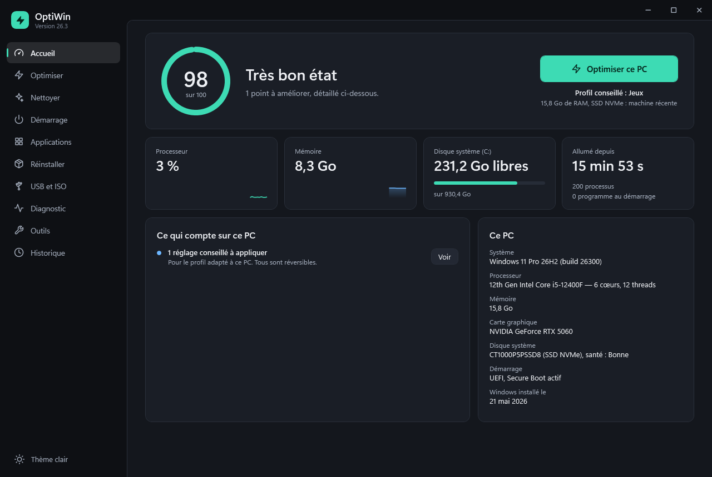
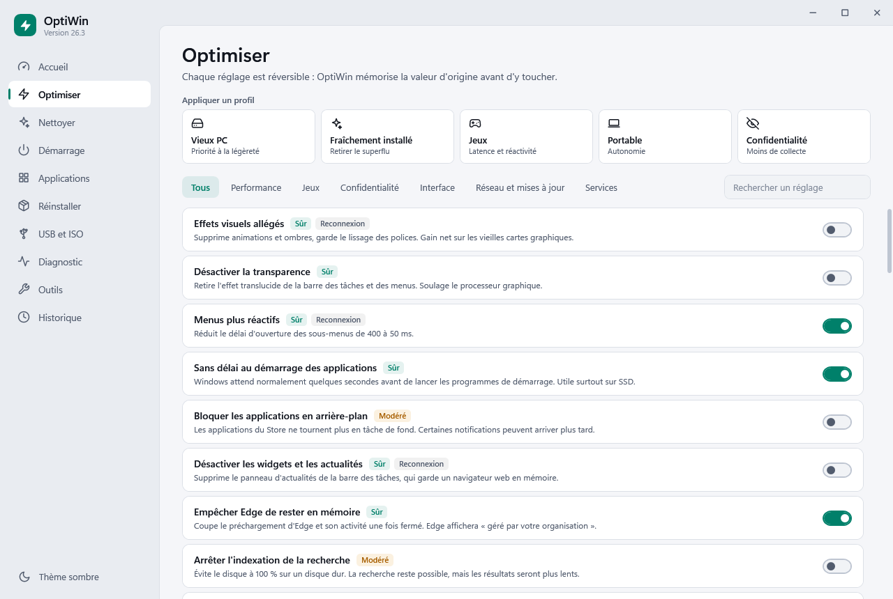
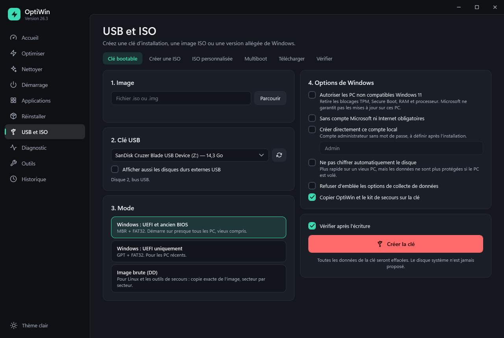
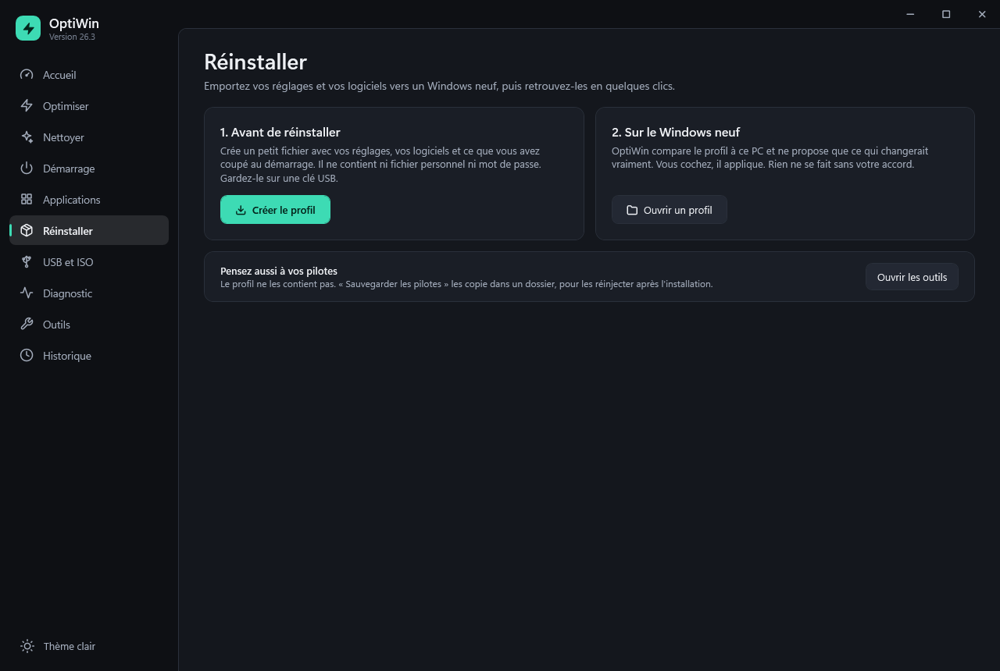
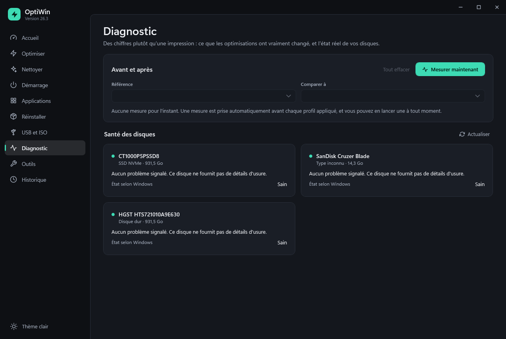

<p align="center">
  
</p>

<h1 align="center">OptiWin</h1>

<p align="center">
  Optimisation de Windows, nettoyage et clés USB bootables.<br>
  Un seul fichier de moins d'un Mo, sans installation. Tout est réversible.
</p>

<p align="center">
  <a href="https://github.com/Paulow78/OptiWin/releases/latest/download/OptiWin.exe"><b>Télécharger OptiWin.exe</b></a>
  ·
  <a href="https://paulow78.github.io/OptiWin/">Site</a>
  ·
  <a href="https://github.com/Paulow78/OptiWin/releases">Toutes les versions</a>
</p>

<p align="center">
  
</p>

## Ce qu'il fait

| Page | Contenu |
|---|---|
| **Accueil** | Score de santé calculé sur des faits mesurés, processeur et mémoire en direct, profil conseillé pour le PC |
| **Optimiser** | 58 réglages réversibles, 5 profils : Vieux PC, Fraîchement installé, Jeux, Portable, Confidentialité. Recherche et filtre par état |
| **Nettoyer** | Caches et fichiers temporaires, et analyse de ce qui occupe le disque |
| **Démarrage** | Activer ou couper les programmes, avec le mécanisme du Gestionnaire des tâches. Les superflus se coupent d'un coup |
| **Applications** | Retirer les applications préinstallées, installer 46 logiciels courants via winget |
| **Réinstaller** | Exporter réglages et logiciels dans un fichier, puis tout retrouver sur un Windows neuf |
| **USB et ISO** | Clé bootable Windows ou Linux, clé multiboot, création d'ISO, ISO allégée, téléchargement de Windows, vérification SHA-256 |
| **Diagnostic** | Mesures avant/après, programmes qui occupent la mémoire, santé réelle des disques (usure, température, erreurs) |
| **Outils** | Réparation DISM/SFC, réseau, Windows Update, Store, test de la mémoire, rapport d'énergie, sauvegarde des pilotes, kit de secours, test DNS, compatibilité Windows 11 |
| **Historique** | Tout ce qui a été changé, annulable un par un ou d'un coup, journal filtrable et exportable |

Raccourcis clavier : Ctrl+1 à Ctrl+0 pour changer de page, F5 pour actualiser, Ctrl+F pour chercher, Ctrl+T pour le thème, Échap pour fermer un dialogue. Les nouveautés de chaque version sont dans [CHANGELOG.md](CHANGELOG.md).

## Ses règles

- **Tout est réversible.** La valeur d'origine est mémorisée avant chaque changement, et un réglage qui échoue en cours de route est défait entièrement.
- **Pas de gadgets.** Pas de nettoyeur de registre ni de « booster de RAM » : leur efficacité n'a jamais été démontrée.
- **La sécurité reste en place.** Defender, Windows Update et les protections Spectre ne sont jamais touchés. Le seul réglage qui réduit la sécurité est hors de tout profil et demande une confirmation.
- **Vos fichiers ne sont pas concernés.** Le nettoyage ne touche ni aux documents ni aux téléchargements, et ne suit jamais un lien symbolique.
- **Le disque système est intouchable.** Seuls les périphériques prouvés USB ou SD sont proposés, le disque est revérifié juste avant l'effacement, et il faut taper `EFFACER`.
- **Windows a le dernier mot.** Quand Windows protège un réglage contre les programmes, OptiWin le signale et ouvre la bonne page des Paramètres, sans contourner la protection.

## Premier lancement

1. Téléchargez [`OptiWin.exe`](https://github.com/Paulow78/OptiWin/releases/latest/download/OptiWin.exe). Il fonctionne sur Windows 10 et 11, sans installation.
2. Windows SmartScreen affichera sans doute « Windows a protégé votre ordinateur », car le programme n'est pas signé numériquement. Cliquez sur **Informations complémentaires**, puis sur **Exécuter quand même**.
3. Acceptez la demande d'administrateur. Si vous la refusez, OptiWin s'ouvre en mode limité, surtout en lecture seule.

Pour vérifier que le fichier est bien celui publié ici, comparez son empreinte avec `SHA256SUMS.txt`, joint à chaque version :

```bash
certutil -hashfile OptiWin.exe SHA256
```

**Désinstaller :** supprimez `OptiWin.exe`. Ses sauvegardes et son journal se trouvent dans `%LOCALAPPDATA%\OptiWin`. Annulez d'abord vos réglages depuis la page Historique si vous voulez revenir à l'état d'origine.

## Clés USB

| Mode | Format | Usage |
|---|---|---|
| Windows : UEFI et BIOS | MBR + FAT32 | Presque tous les PC, vieux compris |
| Windows : UEFI | GPT + FAT32 | PC récents |
| Image brute (DD) | Copie secteur par secteur, relue ensuite | Linux et outils de secours |
| Multiboot | Ventoy, logiciel libre tiers récupéré à la demande | Plusieurs images sur une clé, avec un menu au démarrage |

Un `install.wim` de plus de 4 Go est découpé automatiquement. Chaque clé Windows peut recevoir un **kit de secours** : à lancer depuis l'installateur avec Maj+F10, il copie vos fichiers et répare le démarrage d'un PC en panne.

## Ce qui est vérifié, et ce qui ne l'est pas encore

**Vérifié en conditions réelles, sur Windows 11 :**

- 113 auto-tests (`OptiWin.exe --selftest`) qui ne touchent pas au système : retour arrière des réglages, protection contre les liens symboliques, ISO BIOS + UEFI, téléchargement face à un serveur qui coupe la connexion, fichiers de profil piégés…
- l'application de réglages, le nettoyage et le retrait d'applications, lors d'un usage normal ;
- une vraie clé USB créée en mode « UEFI et BIOS » : un PC a démarré dessus en UEFI, avec Secure Boot actif, et le kit de secours a fonctionné dans l'installateur ;
- la lecture du vrai catalogue de téléchargement de Microsoft.

**Pas encore vérifié :** le démarrage en BIOS, les modes GPT, image brute et multiboot, l'ISO allégée, le téléchargement complet d'une image Windows, une installation avec les réponses automatiques, l'annulation sur le vrai système, et Windows 10, 8.1 et 7.

Faites vos premiers essais avec une clé vide, et testez une ISO allégée dans une machine virtuelle avant de vous y fier.

## Galerie

| | |
|---|---|
|  |  |
|  |  |

## Compiler

Aucun SDK n'est nécessaire : le compilateur C# fourni avec Windows suffit.

```bash
powershell -ExecutionPolicy Bypass -File build.ps1
```

L'exécutable est créé dans `dist\`. Le code se limite au C# 5, la version de ce compilateur. Les icônes reprennent des tracés de Feather et de Lucide : voir [THIRD-PARTY-NOTICES.md](THIRD-PARTY-NOTICES.md).

## Licence

[MIT](LICENSE). Le logiciel est fourni tel quel, sans garantie : sauvegardez vos données avant de modifier votre système ou d'effacer une clé.
